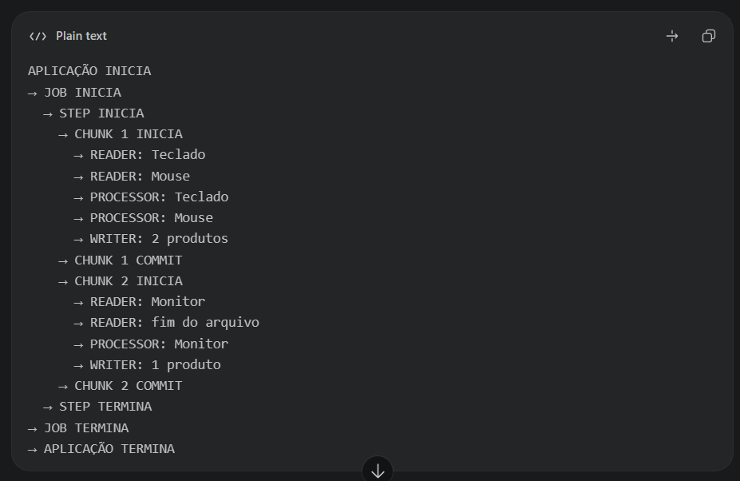

# poc-springbatch-babysteps

## Item 0 — Declaração de objetivo

Esta aplicação tem como objetivo demonstrar, de forma incremental, didática e
observável, o processamento em lote de produtos com Spring Batch. O sistema lê
produtos de um arquivo CSV, aplica um reajuste de 10% ao preço de cada item e
grava o resultado em um novo arquivo CSV, mantendo no banco H2 os metadados
necessários para acompanhar execuções, commits, falhas e reinícios.

O processamento é considerado bem-sucedido quando todos os produtos válidos da
entrada são lidos, transformados e gravados uma única vez na saída, o Job e seu
Step terminam com status `COMPLETED` e os contadores registrados pelo Spring
Batch correspondem aos itens efetivamente processados.

Java 21, Maven, Spring Boot 3.5.7, Spring Batch e H2.

```sh
mvn clean test
mvn spring-boot:run
```

O Job lê `src/main/resources/produtos.csv`, aplica 10% de reajuste e escreve
`produtos-reajustados.csv`, sem cabeçalho. Valores são arredondados para duas
casas decimais com HALF_UP. Execute os comandos na raiz do projeto.

## Passo 8 — execução ponta a ponta

H2 persiste somente os metadados em `data/batch`. O Boot inicializa as tabelas
com `spring.batch.jdbc.initialize-schema=always`.

Resultado validado:

```csv
1,Teclado,110.00
2,Mouse,55.00
3,Monitor,1100.00
```

| STATUS | READ_COUNT | WRITE_COUNT | COMMIT_COUNT | ROLLBACK_COUNT |
| --- | --- | --- | --- | --- |
| COMPLETED | 3 | 3 | 2 | 0 |

O primeiro chunk processa Teclado e Mouse e faz COMMIT. O segundo processa
Monitor e faz COMMIT. O arquivo gerado e o banco local são ignorados pelo Git.

## Passo 9 — metadados

Consultas executadas com a aplicação encerrada, abrindo o mesmo H2 local:

```sql
SELECT * FROM BATCH_JOB_INSTANCE;
```

| JOB_INSTANCE_ID | VERSION | JOB_NAME | JOB_KEY |
| ---: | ---: | --- | --- |
| 1 | 0 | `reajusteProdutoJob` | `d41d8cd98f00b204e9800998ecf8427e` |

```sql
SELECT * FROM BATCH_JOB_EXECUTION;
```

| JOB_EXECUTION_ID | VERSION | JOB_INSTANCE_ID | CREATE_TIME | START_TIME | END_TIME | STATUS | EXIT_CODE | EXIT_MESSAGE | LAST_UPDATED |
| ---: | ---: | ---: | --- | --- | --- | --- | --- | --- | --- |
| 1 | 2 | 1 | `2026-10-16 19:14:41.171` | `2026-10-16 19:14:41.183` | `2026-10-16 19:14:41.238` | `COMPLETED` | `COMPLETED` | — | `2026-10-16 19:14:41.240` |
| 2 | 2 | 1 | `2026-10-16 19:39:06.116` | `2026-10-16 19:39:06.128` | `2026-10-16 19:39:06.150` | `COMPLETED` | `NOOP` | Todos os steps já estavam concluídos | `2026-10-16 19:39:06.152` |

```sql
SELECT STEP_NAME, STATUS, READ_COUNT, WRITE_COUNT, COMMIT_COUNT, ROLLBACK_COUNT
FROM BATCH_STEP_EXECUTION;
```

| STEP_NAME | STATUS | READ_COUNT | WRITE_COUNT | COMMIT_COUNT | ROLLBACK_COUNT |
| --- | --- | ---: | ---: | ---: | ---: |
| `reajusteProdutoStep` | `COMPLETED` | 3 | 3 | 2 | 0 |

A primeira execução processou os três produtos. A segunda pertence à mesma
JobInstance e terminou com `EXIT_CODE=NOOP`, pois o Step já estava concluído e
nenhum parâmetro identificador diferente foi informado.

`JobInstance → JobExecution → StepExecution`: a instância identifica o Job
pelo nome e pelos parâmetros identificadores; uma execução registra uma tentativa;
a execução do Step registra contagens, status e contexto para retomada.
O JobRepository persiste esses dados. Nenhuma tabela de negócio foi criada.

Para consultar com o cliente incluído no H2 (ajuste o caminho do JAR à versão local):

```sh
java -cp ~/.m2/repository/com/h2database/h2/2.3.232/h2-2.3.232.jar \
  org.h2.tools.Shell -url jdbc:h2:file:./data/batch -user sa -password ''
```

Use esse cliente com a aplicação encerrada para evitar disputa pelo arquivo H2.

## Passo 10 — falha proposital

O commit deste passo lança `RuntimeException("Erro proposital ao processar Mouse")`
no Processor. Comando utilizado:

```sh
mvn spring-boot:run -Dspring-boot.run.arguments=caso=restart-demo
```

| JobInstance | JobExecution | STATUS | READ_COUNT | WRITE_COUNT | COMMIT_COUNT | ROLLBACK_COUNT |
| --- | --- | --- | --- | --- | --- | --- |
| 2 | 2 | FAILED | 2 | 0 | 0 | 1 |

Teclado e Mouse foram lidos no mesmo chunk de tamanho 2. O Processor falhou
antes de o Writer receber o chunk; nenhum item foi escrito e a transação sofreu
rollback. O arquivo ficou vazio. READ_COUNT=2 registra as leituras observadas
na tentativa, não dois itens confirmados. O código de saída do Maven foi zero:
`BUILD SUCCESS` sozinho não comprova sucesso do Job; consulte seu STATUS.

O Writer de arquivo participa por buffering e estado de restart; um arquivo
não oferece a mesma atomicidade física de uma tabela transacional em todos os
cenários de queda. Aqui a falha aconteceu antes da escrita do primeiro chunk.

## Passo 11 — restart

Removida a falha, executei exatamente o mesmo comando e parâmetro do passo 10.
Não apaguei tabelas, banco, contextos nem o arquivo vazio.

| JobInstance | JobExecution | STATUS | READ_COUNT | WRITE_COUNT | COMMIT_COUNT | ROLLBACK_COUNT |
| --- | --- | --- | --- | --- | --- | --- |
| 2 | 2 | FAILED | 2 | 0 | 0 | 1 |
| 2 | 3 | COMPLETED | 3 | 3 | 2 | 0 |

As execuções 2 e 3 têm `caso=restart-demo`, `IDENTIFYING=Y`, e apontam à mesma
JobInstance 2: isso é restart. Cada tentativa tem seu próprio JobExecution e
StepExecution; o histórico FAILED é preservado. Como nenhum chunk tinha sido
confirmado, o restart leu os três registros desde o início. O CSV final foi
validado novamente, sem duplicatas.

Mudar um parâmetro identificador cria outra JobInstance, não um restart.
Repetir uma instância já COMPLETED é rejeitado. Para uma nova execução manual:

```sh
mvn spring-boot:run -Dspring-boot.run.arguments=caso=nova-execucao-01
```

Use outro valor a cada nova instância desejada. Evite timestamps automáticos
quando quiser demonstrar restart: eles mudariam a identidade.

Consulta antes e depois:

```sql
SELECT JOB_EXECUTION_ID, JOB_INSTANCE_ID, STATUS FROM BATCH_JOB_EXECUTION;
SELECT JOB_EXECUTION_ID, PARAMETER_NAME, PARAMETER_VALUE, IDENTIFYING
FROM BATCH_JOB_EXECUTION_PARAMS;
SELECT JOB_EXECUTION_ID, STEP_NAME, STATUS, READ_COUNT, WRITE_COUNT,
       COMMIT_COUNT, ROLLBACK_COUNT FROM BATCH_STEP_EXECUTION;
```

## Passo 12 — observabilidade mínima

`BatchLoggingListener` registra início e fim de Job e Step, IDs de execução,
status, quantidade lida/escrita e duração em milissegundos. Não há log por item.
Exemplo observado em `caso=observabilidade` (JobExecution 4):

```text
Fim Step=reajusteProdutoStep executionId=4 status=COMPLETED lidos=3 escritos=3 tempoMs=42
Fim Job=reajusteProdutoJob executionId=4 status=COMPLETED lidos=3 escritos=3 tempoMs=71
```

As contagens do Job são a soma dos Steps executados nessa tentativa; os tempos
variam a cada execução. Os metadados continuam sendo a fonte para o histórico.

## Passo 13 — teste de integração

`ProdutoJobIntegrationTest` carrega a aplicação, dispara o Job via JobLauncher
com o parâmetro identificador `caso=integracao` e verifica:

- BatchStatus.COMPLETED;
- 3 leituras, 3 escritas, 2 commits e 0 rollbacks;
- as três linhas exatas do CSV final.

O teste usa Reader, Processor e Writer reais. H2 em memória e diretório
`@TempDir` isolam seus artefatos do histórico e do arquivo da execução manual.
O disparo automático do Boot é desabilitado apenas no teste. Os listeners de
teste ficam limitados à injeção de dependências: não há mocks nem necessidade
de anexar agente Mockito, operação indisponível neste ambiente.

Validação final: `mvn clean test`, 4 testes, 0 falhas e 0 erros.

## Conceitos e evolução

```text
              Job
               │
               ▼
              Step
               │
        chunk transaction
               │
    ┌──────────┼───────────┐
    ▼          ▼           ▼
 Reader    Processor     Writer
    │          │           │
    ▼          ▼           ▼
  CSV       Regra        CSV
```

O Job organiza o fluxo. O Step lê até dois produtos por chunk, transforma cada
produto e entrega o grupo ao Writer. O transactionManager delimita commit ou
rollback. O JobRepository registra JobInstance, JobExecution e StepExecution,
além dos contextos que permitem restart. Falha e restart estão demonstrados
nos passos 10 e 11; o teste de integração comprova o fluxo completo.

| Passo | Arquivos principais | Validação realizada |
| --- | --- | --- |
| 1 | pom.xml, BatchApplication, application.properties | clean test e aplicação |
| 2 | Produto, produtos.csv | compilação e CSV no classpath |
| 3 | ReaderConfig, ReaderConfigTest | 1 teste |
| 4 | ProdutoProcessor, ProdutoProcessorTest | 3 testes |
| 5 | WriterConfig | compilação e 3 testes |
| 6 | StepConfig | compilação e 3 testes |
| 7 | JobConfig | 3 testes e aplicação |
| 8 | application.properties, .gitignore, README | 3 testes, aplicação, CSV e SQL |
| 9 | README | 3 testes e consultas SQL |
| 10 | ProdutoProcessor, README | 3 testes e execução FAILED esperada |
| 11 | ProdutoProcessor, README | 3 testes, restart, CSV e SQL |
| 12 | BatchLoggingListener, JobConfig, StepConfig, README | 3 testes e logs reais |
| 13 | ProdutoJobIntegrationTest, README | clean test, 4 testes |

Cada passo possui seu próprio commit. A falha proposital existe apenas no
commit do passo 10; o código final está corrigido.

### Ferramentas neste workspace

Maven e JDK completo foram instalados em `/tmp`, pois o ambiente inicialmente
continha apenas o runtime Java. Para reutilizar as ferramentas e o cache locais:

```sh
export JAVA_HOME=/tmp/jdk21
export PATH=/tmp/apache-maven-3.9.11/bin:$JAVA_HOME/bin:$PATH
mvn -o -Dmaven.repo.local=/tmp/maven-repository clean test
mvn -o -Dmaven.repo.local=/tmp/maven-repository spring-boot:run \
  -Dspring-boot.run.arguments=caso=nova-execucao-02
```

O modo offline usa as dependências já baixadas. Fora deste ambiente, basta ter
JDK 21 e Maven disponíveis e executar os comandos convencionais no início do README.


## Ordem Completa Observada



## Log Organizado da Aplicacao

| Data e hora | Evento |
|---|---|
| 16/10/2026 19:14:40.393 | Aplicação iniciando com Java 21.0.12.1, PID `3368`. |
| 16/10/2026 19:14:40.393 | Spring Boot `3.5.7` e Spring `6.2.12`. |
| 16/10/2026 19:14:40.393 | Nenhum perfil ativo; usando o perfil `default`. |
| 16/10/2026 19:14:40.818 | Iniciando pool de conexões `HikariPool-1`. |
| 16/10/2026 19:14:40.987 | Conexão criada com o banco H2 `jdbc:h2:file:./data/batch`, usuário `SA`. |
| 16/10/2026 19:14:40.988 | Pool de conexões iniciado. |
| 16/10/2026 19:14:41.152 | Aplicação iniciada em `1,012 s`. |
| 16/10/2026 19:14:41.154 | Execução iniciada sem argumentos. |
| 16/10/2026 19:14:41.177 | Job `reajusteProdutoJob` disparado sem parâmetros. |
| 16/10/2026 19:14:41.190 | `[JOB][INÍCIO]` Execução `1` iniciada. |
| 16/10/2026 19:14:41.196 | Step `reajusteProdutoStep` acionado. |
| 16/10/2026 19:14:41.200 | `[STEP][INÍCIO]` Step da execução `1` iniciado. |
| 16/10/2026 19:14:41.207 | `[CHUNK][INÍCIO]` Chunk `1` iniciado. |
| 16/10/2026 19:14:41.207 | `[READER]` Aguardando primeiro item. |
| 16/10/2026 19:14:41.225 | `[READER][ITEM LIDO]` Produto `1`: Teclado, preço `100,00`. |
| 16/10/2026 19:14:41.226 | `[READER]` Aguardando segundo item. |
| 16/10/2026 19:14:41.227 | `[READER][ITEM LIDO]` Produto `2`: Mouse, preço `50,00`. |
| 16/10/2026 19:14:41.227 | `[PROCESSOR][INÍCIO]` Processando produto `1`. |
| 16/10/2026 19:14:41.227 | `[PROCESSOR][CÁLCULO]` Teclado reajustado em `10%`: `100,00 → 110,00`. |
| 16/10/2026 19:14:41.228 | `[PROCESSOR][INÍCIO]` Processando produto `2`. |
| 16/10/2026 19:14:41.228 | `[PROCESSOR][CÁLCULO]` Mouse reajustado em `10%`: `50,00 → 55,00`. |
| 16/10/2026 19:14:41.228 | `[WRITER][INÍCIO]` Preparando escrita de `2` itens. |
| 16/10/2026 19:14:41.228 | `[WRITER][ITEM ESCRITO]` Teclado gravado com preço `110,00`. |
| 16/10/2026 19:14:41.229 | `[WRITER][ITEM ESCRITO]` Mouse gravado com preço `55,00`. |
| 16/10/2026 19:14:41.229 | `[WRITER][FIM]` Escrita dos `2` itens concluída. |
| 16/10/2026 19:14:41.230 | `[CHUNK][COMMIT]` Chunk `1` confirmado: 2 lidos, 2 escritos e 1 commit. |
| 16/10/2026 19:14:41.230 | `[CHUNK][INÍCIO]` Chunk `2` iniciado. |
| 16/10/2026 19:14:41.231 | `[READER]` Aguardando próximo item. |
| 16/10/2026 19:14:41.231 | `[READER][ITEM LIDO]` Produto `3`: Monitor, preço `1.000,00`. |
| 16/10/2026 19:14:41.231 | `[READER]` Tentativa de leitura seguinte para detectar o fim do arquivo. |
| 16/10/2026 19:14:41.231 | `[PROCESSOR][INÍCIO]` Processando produto `3`. |
| 16/10/2026 19:14:41.231 | `[PROCESSOR][CÁLCULO]` Monitor reajustado em `10%`: `1.000,00 → 1.100,00`. |
| 16/10/2026 19:14:41.231 | `[WRITER][INÍCIO]` Preparando escrita de `1` item. |
| 16/10/2026 19:14:41.231 | `[WRITER][ITEM ESCRITO]` Monitor gravado com preço `1.100,00`. |
| 16/10/2026 19:14:41.232 | `[WRITER][FIM]` Escrita do item concluída. |
| 16/10/2026 19:14:41.233 | `[CHUNK][COMMIT]` Chunk `2` confirmado: 3 lidos, 3 escritos e 2 commits acumulados. |
| 16/10/2026 19:14:41.234 | Step executado em `37 ms`. |
| 16/10/2026 19:14:41.235 | `[STEP][RESUMO]` Status `COMPLETED`: 3 lidos, 3 escritos, 2 commits, nenhum filtro, skip ou rollback. |
| 16/10/2026 19:14:41.239 | `[JOB][RESUMO]` Status `COMPLETED`: 3 lidos, 3 escritos, duração de `55 ms`. |
| 16/10/2026 19:14:41.241 | Conclusão do job confirmada pelo Spring Batch. |
| 16/10/2026 19:14:41.248 | Encerramento do pool de conexões iniciado. |
| 16/10/2026 19:14:41.309 | Pool de conexões encerrado. |
